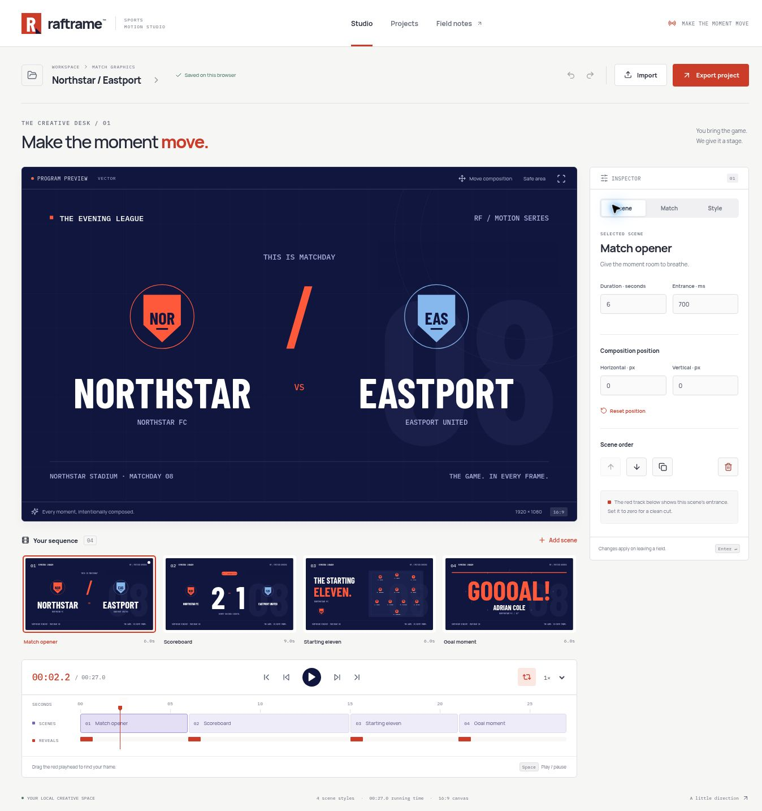

# Raftrame

**Make the moment move.** An original React and TypeScript studio for composing sports broadcast graphics, directing their timing, and carrying editable projects between browsers.

Built by **Rafayel Karamyan** as an independent portfolio product. Teams, matches and graphics are fictional and authored for this project.

[Open the live studio](https://rafayelkaramyan.github.io/raftrame/) · [Verified build and browser checks](https://github.com/RafayelKaramyan/raftrame/actions/runs/39773826788)



The published build passed 42 unit/integration tests and all 54 browser cases across Chromium, Firefox and Pixel 7 emulation. Editing, reload persistence, JSON export/import and 1920 × 1080 PNG export were also verified on the live demo. See the [validation record](docs/validation.md) for the release evidence and testing limits.

## Quick tour

1. Choose a scene in **Your sequence**, then open **Match** to edit the teams, score or starting eleven.
2. Scrub the timeline or press **Space** to preview the sequence. Use **Scene** to adjust timing and position, or **Style** to change the art direction.
3. Open **Export project** to download an editable JSON project or a PNG of the current frame. Import the JSON to continue as a separate editable copy.

## The studio

The workspace is built around a large 16:9 program stage, a scene filmstrip, a two-track timeline and a focused inspector. Three art directions pair Barlow Condensed with Manrope and IBM Plex Mono; all fonts are self-hosted. The mark, team crests, pitch and scene graphics are drawn in code.

- Four scene types: match opener, scoreboard, starting eleven and goal moment.
- Edit match data once; every scene uses the same teams, score, competition and lineup.
- Add, duplicate, reorder and remove scenes. Set duration, entrance and composition position.
- Seek any frame, play at four speeds, loop, and move the composition with a pointer or keyboard.
- Undo/redo with a bounded session history; three palettes and editable team accents.
- Up to 24 projects per browser, each with 1–12 scenes. Create, search, duplicate and remove projects.
- Export editable JSON and import it as an independent copy with fresh identities. Export a 1920 × 1080 PNG of the current frame.
- Browser persistence with atomic revision checks, generation checks, rejected-write recovery and unreadable-data recovery.
- Native modal focus containment, keyboard controls, reduced motion and responsive layouts.

## Run locally

Use Node.js 22.12 or later.

```sh
npm ci
npm run dev
```

Open `http://localhost:4173/raftrame/`. The same deployment base is used locally and on GitHub Pages.

```sh
npm run check
npm run build
npx playwright install --with-deps chromium firefox
npm run test:e2e
```

The browser suite runs against the production build. GitHub Actions verifies before publishing Pages and retains reports and screenshots as workflow artifacts.

## Engineering

`evaluateFrame(project, timeMs, reducedMotion)` is a pure scene evaluator. It creates renderer-independent primitives from an absolute timeline position. PixiJS retains text and geometry objects between frames; an SVG renderer provides previews and a fallback when WebGL cannot initialize or its context is lost. PNG export uses the same primitives through Canvas 2D.

The transport notifies the renderer on animation frames and throttles React subscribers to 20 updates per second. It starts paused and pauses when the tab is hidden. Scene timing never depends on how many frames were rendered.

Zod validates portable projects and browser records. IndexedDB read/write transactions compare a workspace revision and generation before committing. A sequential save queue retains newer in-memory edits while a previous snapshot is being saved. BroadcastChannel announces changes between tabs; competing edits require explicit recovery rather than silently replacing a newer saved document.

Read the [architecture](docs/architecture.md), [code walkthrough](docs/walkthrough.md), and [validation record](docs/validation.md).

## Scope

This is a browser-local creative tool, with fictional sports data. It has no authentication, cloud synchronization, live sports feed, video encoding, broadcasting integration or external dispatch. PNG is a still frame; JSON is an editable project, not a video. Undo history lasts for the current editing session and retains up to 50 earlier snapshots. Browser storage can be cleared or evicted; exported project files are the portable backup.

The vector fallback and Canvas export use browser text metrics, so exact raster pixels may differ from WebGL across browsers. Custom low-contrast team accents are allowed as creative content; the application controls retain their own accessible palette. Long player names are abbreviated visually to fit the pitch while their complete values stay editable and portable.

GitHub Pages serves client routes through a `404.html` fallback; direct nested routes can render the application while retaining an HTTP 404 response.

## Credits

React, React Router, PixiJS, Zod and Lucide are dependencies, not copied product interfaces. Barlow Condensed, Manrope and IBM Plex Mono are distributed through Fontsource under their included licenses. No external image service or runtime account is required.

Copyright © 2026 Rafayel Karamyan. Original application source and graphics; dependency licenses remain with their respective authors.
